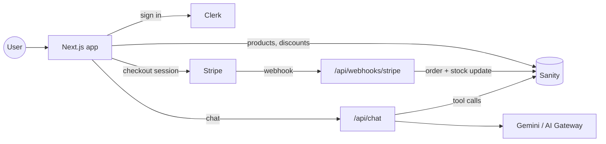

# StoreCraft

An e-commerce store with a built-in AI shopping assistant. Products, variants and discount codes are managed in Sanity, payments go through Stripe Checkout, and users sign in with Clerk. The assistant can search the catalog, recommend products and add the right size or model to your cart.

[](https://github.com/Lahanas/StoreCraft-ai/actions/workflows/ci.yml)


## Features

**Storefront**
- 184 products across 9 categories, with real product photos, brands and customer reviews
- Search, category filters, sorting and pagination
- Product pages with an image gallery, variant picker and stock for each variant
- Cart drawer that keeps its contents after a reload and stays in sync across open tabs
- Order history for signed-in users

**Variants and inventory**
- Products can have options such as size, storage or memory, and each variant has its own SKU, price and stock
- Sold-out variants stay visible but can't be added
- Stock is tracked per variant and decremented when an order is paid

**Discount codes**
- Codes are created and managed in Sanity Studio: percentage or fixed amount, minimum spend, start and end dates, usage limit
- The cart shows the discount and new total as soon as a code is applied
- The server checks the code again at checkout and passes the exact amount to Stripe

**Payments**
- Stripe Checkout, with prices, stock and discounts checked on the server before a session is created
- A webhook that records each paid order exactly once, even if Stripe sends the event more than once

**AI assistant**
- Built with the Vercel AI SDK using tool calling
- Tools: search products, get product details, recommend similar items, list categories, add to cart
- Asks which size or model you want before adding a product that has options
- Results appear as product cards in the chat, and "add to cart" updates the real cart
- Available to signed-in users only

**Quality**
- 38 unit tests with Vitest covering pricing, discounts, checkout validation, webhook idempotency, the cart and the GROQ queries
- GitHub Actions runs lint, typecheck, tests and a production build on every push

## Tech stack

| Area | Technology |
| --- | --- |
| Framework | Next.js 16 (App Router), React 19, TypeScript |
| Styling | Tailwind CSS v4 |
| CMS | Sanity (embedded Studio, GROQ, image CDN) |
| Payments | Stripe Checkout and webhooks |
| Auth | Clerk (email and OAuth) |
| AI | Vercel AI SDK with Google Gemini (or any model through the Vercel AI Gateway) |
| State | Zustand |
| Validation | Zod |
| Testing | Vitest, groq-js, GitHub Actions |

## How it works



**Variants.** Every product has at least one variant, the same way Shopify models products. A cart line is a product plus a variant key, and stock lives on the variant. Products without options have a single "Default" variant, so the cart, checkout and webhook only deal with one shape.

**Checkout.** The browser sends only product ids, variant keys, quantities and an optional discount code. The server loads current prices and stock from Sanity, checks the discount rules in `src/lib/pricing.ts`, then creates the Stripe Checkout Session. The discount is passed to Stripe as a one-off coupon for the exact amount, so Stripe's total always matches the store's. An idempotency key stops a double-click from creating two sessions.

**Webhooks.** Stripe can deliver the same event more than once, sometimes at the same time. Each paid session maps to one order whose id is built from the session id (`order-<session id>`). The order, the stock decrements and the discount usage count are written in a single Sanity transaction that fails if the order already exists. A repeated event therefore changes nothing, and the webhook still answers `200` so Stripe stops retrying. The tests in `src/lib/fulfillment.test.ts` cover repeated and concurrent deliveries.

**Assistant.** `/api/chat` streams a response from the model with five tools defined in `src/lib/ai-tools.ts`. Every tool reads from Sanity, so the assistant can't invent products or prices. The current cart is sent with each message so the assistant knows what you already have.

## Getting started

### Prerequisites

- Node.js 20.9 or newer
- Accounts on [Sanity](https://www.sanity.io), [Clerk](https://clerk.com), [Stripe](https://stripe.com) and [Google AI Studio](https://aistudio.google.com). The free tiers are enough.
- The [Stripe CLI](https://docs.stripe.com/stripe-cli) for testing webhooks locally

### 1. Install

```bash
git clone https://github.com/Lahanas/StoreCraft-ai.git
cd StoreCraft-ai
npm install
cp .env.example .env.local
```

### 2. Configure services

**Sanity**
1. Create a project at [sanity.io/manage](https://www.sanity.io/manage).
2. Copy the project ID into `NEXT_PUBLIC_SANITY_PROJECT_ID`.
3. Under API → Tokens, create a token with Editor access and set it as `SANITY_API_WRITE_TOKEN`.
4. Under API → CORS origins, add `http://localhost:3000` with credentials allowed.

**Clerk**
1. Create an application in the [Clerk dashboard](https://dashboard.clerk.com).
2. Copy the publishable and secret keys into `.env.local`.
3. Optional: enable Google or GitHub under SSO connections.

**Stripe**
1. Copy your test-mode secret key into `STRIPE_SECRET_KEY`.
2. In a separate terminal, run `npm run stripe:listen` and copy the `whsec_...` secret it prints into `STRIPE_WEBHOOK_SECRET`.

**AI model**
1. Create a free key at [aistudio.google.com/apikey](https://aistudio.google.com/apikey) and set it as `GOOGLE_GENERATIVE_AI_API_KEY`. No credit card is needed.
2. Optional: change the model with `GOOGLE_MODEL` (default: `gemini-flash-lite-latest`).
3. Alternative: leave the Google key empty and set `AI_GATEWAY_API_KEY` and `AI_MODEL` to use any model through the [Vercel AI Gateway](https://vercel.com/ai-gateway) instead.

Run `npx tsx scripts/debug-ai.ts` to check that the model responds and can call tools.

### 3. Seed and run

```bash
npm run seed   # loads products, photos and discount codes (safe to run again)
npm run dev
```

The first seed uploads about 420 product photos to Sanity and takes a few minutes. Later runs skip photos that are already uploaded.

Open [localhost:3000](http://localhost:3000). The Studio is at [localhost:3000/studio](http://localhost:3000/studio).

To test a payment, use card `4242 4242 4242 4242` with any future expiry date and any CVC. These discount codes are seeded:

| Code | Discount |
| --- | --- |
| `WELCOME10` | 10% off |
| `SAVE25` | $25 off orders over $150 |
| `SUMMER20` | Expired, to show the error message |

## Environment variables

| Variable | Description |
| --- | --- |
| `NEXT_PUBLIC_SANITY_PROJECT_ID` | Sanity project ID |
| `NEXT_PUBLIC_SANITY_DATASET` | Dataset name, usually `production` |
| `NEXT_PUBLIC_SANITY_API_VERSION` | Sanity API version date |
| `SANITY_API_WRITE_TOKEN` | Editor token used by the seed script and the webhook |
| `NEXT_PUBLIC_CLERK_PUBLISHABLE_KEY` | Clerk publishable key |
| `CLERK_SECRET_KEY` | Clerk secret key |
| `STRIPE_SECRET_KEY` | Stripe secret key |
| `STRIPE_WEBHOOK_SECRET` | Signing secret for the webhook endpoint |
| `GOOGLE_GENERATIVE_AI_API_KEY` | Google Gemini API key (free tier) |
| `GOOGLE_MODEL` | Optional Gemini model ID |
| `AI_GATEWAY_API_KEY` | Vercel AI Gateway key, used only when no Google key is set |
| `AI_MODEL` | Gateway model ID |
| `NEXT_PUBLIC_SITE_URL` | Base URL used for Stripe redirects |

## Scripts

| Command | Description |
| --- | --- |
| `npm run dev` | Start the development server |
| `npm run build` | Build for production |
| `npm run start` | Run the production build |
| `npm run lint` | Run ESLint |
| `npm run typecheck` | Generate route types and run the TypeScript compiler |
| `npm test` | Run the unit tests |
| `npm run seed` | Seed Sanity with products, photos and discount codes |
| `npm run stripe:listen` | Forward Stripe webhooks to your local server |

## Project structure

```
src/
├── app/
│   ├── (store)/              # Storefront pages
│   │   ├── products/         # Catalog and product pages
│   │   ├── orders/           # Order history (signed-in only)
│   │   └── checkout/success/
│   ├── api/
│   │   ├── chat/             # AI assistant
│   │   ├── checkout/         # Creates Stripe Checkout Sessions
│   │   ├── discounts/        # Checks a discount code for the cart
│   │   └── webhooks/stripe/  # Records paid orders
│   └── studio/               # Sanity Studio
├── components/               # UI components (cart drawer, variant picker, chat widget, ...)
├── lib/
│   ├── pricing.ts            # Subtotals and discount rules
│   ├── checkout.ts           # Cart validation against live stock
│   ├── fulfillment.ts        # Idempotent order creation
│   ├── ai-tools.ts           # Assistant tools
│   └── ...                   # Catalog queries, cart store, Stripe client
├── sanity/                   # Sanity client, schemas and queries
└── proxy.ts                  # Clerk middleware
scripts/
├── seed.ts                   # Catalog seed script
└── data/products.json        # Product data
```

## Deployment

The app is set up to deploy on Vercel.

1. Import the repository in Vercel.
2. Add all the variables from `.env.example`, using live keys for production.
3. Set `NEXT_PUBLIC_SITE_URL` to your production domain.
4. In Stripe, add a webhook endpoint at `https://<your-domain>/api/webhooks/stripe` that listens for `checkout.session.completed` and `checkout.session.async_payment_succeeded`. Put its signing secret in `STRIPE_WEBHOOK_SECRET`.
5. Add your production domain to Sanity's CORS origins and to your Clerk application.

## Credits

Product data and photos come from [DummyJSON](https://github.com/Ovi/DummyJSON) (MIT license).
